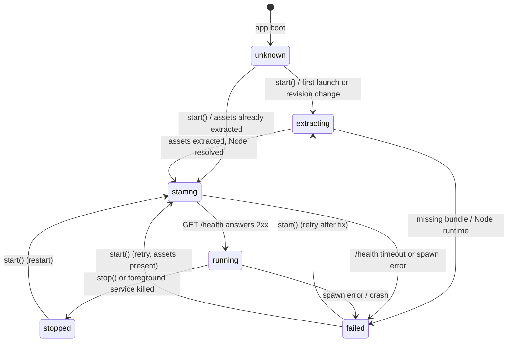

# OAgents architecture

This document expands the architecture section of the
[README](../README.md). It covers five contracts that together define how
OAgents drives a single AI backend — the opencode CLI, embedded on-device
inside a **full Node.js toolbox**:

1. The [opencode HTTP contract](#1-opencode-http-contract) — endpoints and
   the SSE event schema, from
   [`lib/services/opencode_client.dart`](../lib/services/opencode_client.dart).
2. The [platform channel contract](#2-platform-channel-contract) — method
   and event channels between Dart and the Kotlin
   `OpencodeRuntimeBridge`, from
   [`lib/services/opencode_runtime.dart`](../lib/services/opencode_runtime.dart)
   and
   [`android/app/src/main/kotlin/com/secretarrow/oagents/OpencodeRuntimeBridge.kt`](../android/app/src/main/kotlin/com/secretarrow/oagents/OpencodeRuntimeBridge.kt).
3. The [`OpencodeRuntimeState` state machine](#3-opencoderuntimestate-state-machine).
4. How the [agent loop, cron scheduler, subagents runner, and module
   runtime](#4-who-consumes-the-embedded-llmconfig) all consume the embedded
   `LlmConfig`.
5. The [bundled Node toolbox + manifest contract](#5-bundled-node-toolbox--manifest-contract)
   — the `filesDir/toolbox/` tree, the bridge launch sequence (extract →
   select ABI → chmod → spawn with `PATH`/`NODE_PATH` env), the
   `modules.json` manifest read by `ToolboxManifestLoader` in
   [`lib/services/toolbox_manifest.dart`](../lib/services/toolbox_manifest.dart),
   and the Playwright-on-Android limitation in detail.

The fixed loopback endpoint the embedded opencode listens on:

```dart
const String embeddedOpencodeUrl = 'http://127.0.0.1:4096';
const int embeddedOpencodePort = 4096;
```

This is reachable only from inside the app sandbox. No other app and no
network host can reach it, so the app → opencode hop needs no auth. The
process that answers on that port is `node opencode.bundle.js serve --port
4096` running inside the extracted `filesDir/toolbox/` tree (see
[section 5](#5-bundled-node-toolbox--manifest-contract)); opencode's **own**
provider auth (OpenAI / Anthropic API keys) is still opencode's business via
`opencode auth login` and OAgents stores zero credentials.

---

## 1. opencode HTTP contract

The contract lives in
[`lib/services/opencode_client.dart`](../lib/services/opencode_client.dart).
It is intentionally OpenAI-shaped so the wire format is well-understood,
trivially mockable (the mock server in `test/support/` is the only other
place this contract is implemented), and stable across opencode revisions.

Base URL is the fixed `embeddedOpencodeUrl` (no trailing slash). Auth is
`Authorization: Bearer <token>` only when the token is non-empty — for the
embedded runtime the token is always empty (loopback, unauthenticated).

### Endpoints

| Endpoint | Method | Purpose |
|---|---|---|
| `/health` | `GET` | Connection probe. Returns any `2xx` with no body. Used by the Kotlin bridge's startup poll and by the Settings → opencode "Test connection" affordance. |
| `/models` | `GET` | Feeds the model picker. Returns `{"data":[{"id":String,"name":String}]}`. A bare JSON array is also accepted. Items with an empty `id` are dropped. On any failure the picker falls back to manual entry (returns an empty list, never throws). |
| `/chat/completions` | `POST` | SSE stream. Request body below. |

### `POST /chat/completions` request body

```json
{
  "model": "<opencode model id, or empty>",
  "messages": [{"role": "system|user|assistant|tool", "content": "..."}],
  "stream": true,
  "tools": ["...optional OpenAI tool schema..."],
  "tool_choice": "auto",
  "stream_options": {"include_usage": true}
}
```

`tools` and `tool_choice` are sent only when tools are non-empty.
`stream_options.include_usage` asks the server for a final usage chunk;
servers that do not understand the field ignore it. If the server replies
`400` and the error body mentions `stream_options`, the client retries once
without it (usage simply stays null) so chat keeps working on stricter
frontends.

Request headers:

```
Authorization: Bearer <authToken>   // omitted when authToken is empty
Content-Type: application/json
Accept: text/event-stream
X-Title: OAgents
```

The body is JSON-encoded off the UI isolate (`Isolate.run`) because a long
conversation with base64 attachments can be multiple MB and a main-thread
`jsonEncode` stalls every frame.

### SSE event schema

The response is `Content-Type: text/event-stream`. Each event is a
`data: <json>\n\n` line. OAgents understands four shapes:

```
data: {"choices":[{"delta":{"content":"text chunk"}}]}              // assistant text
data: {"choices":[{"delta":{"tool_calls":[{...}]}}]}                 // tool call
data: {"choices":[],"usage":{"prompt_tokens":N,"completion_tokens":M}}  // usage
data: [DONE]                                                         // stream end
```

- **Text chunk** — `choices[0].delta.content` (a non-empty string) is
  appended to the running assistant text and emitted to the UI via
  `onDelta`.
- **Tool call** — `choices[0].delta.tool_calls` is an array; each entry is
  accumulated by `index` into a `_ToolAccumulator` (`id`, `function.name`,
  `function.arguments` streamed as a string). Tool-call JSON is only
  surfaced once the stream ends cleanly — a dropped socket mid-stream
  discards half-received tool calls (their JSON would be truncated) but
  keeps usable partial text.
- **Usage** — captured even on a chunk with empty `choices` (the final
  `include_usage` emission). Parsed into `TokenUsage`.
- **`[DONE]`** — stream end.

Lines starting with `:` (SSE comments) and empty lines are skipped. Lines
not starting with `data:` are skipped. Malformed JSON payloads are skipped
(the stream continues).

### Non-streaming fallback

If the server replies `200` but with a non-`text/event-stream`
`Content-Type` (it ignored `stream: true`), the client parses a plain JSON
response: `choices[0].message.content`, `choices[0].message.tool_calls`,
and `usage`.

### Error handling

- Non-2xx responses carry an error body surfaced verbatim, truncated to
  600 chars (300 for the `400` `stream_options` path) so auth and config
  mistakes are diagnosable in-app. The status code is attached to the
  `LlmException`.
- A connection failure (`client.send` throws) becomes
  `LlmException('Could not connect to opencode server: …')`.
- A dropped socket mid-stream becomes
  `LlmException('Connection lost while streaming: …')` unless partial text
  is recoverable and there are no in-flight tool calls.
- `isRetryableOpencodeError` returns true for transport failures (unreachable
  server, dropped stream, socket/timeout) and transient HTTP responses
  (`408` / `425` / `429` / `5xx`). Auth and bad-request errors are
  permanent — retrying them only burns the budget. A user-initiated abort
  (`LlmAbortedException`, the Stop button) is never retried.

### Per-call cancellation

Every `chatStream` call registers its `http.Client` with `LlmClient`'s live
stream registry under a `cancelKey`, so `LlmClient.forceCancel` can tear the
stream down mid-flight even when the stream has gone silent (the
`shouldAbort` poll only runs between chunks). The client is unregistered
and closed in a `finally` block.

---

## 2. Platform channel contract

The embedded opencode CLI lifecycle is driven through two channels between
Dart and the Kotlin `OpencodeRuntimeBridge`:

| Channel | Type | Name |
|---|---|---|
| Method | `MethodChannel` | `com.secretarrow.oagents/opencode` |
| Event | `EventChannel` | `com.secretarrow.oagents/opencode/status` |

### Method channel — `com.secretarrow.oagents/opencode`

Every method is defensive: nothing throws across the channel. A failure
comes back as a status map with `state = "failed"` and a human-readable
`message`.

| Method | Args | Returns | Effect |
|---|---|---|---|
| `start` | none | `{"state":"starting", …}` (immediate), then status events | Spawns a background thread that extracts the bundled toolbox tarball to `filesDir/toolbox/` on first launch, selects the Node binary for the device ABI, starts the foreground service, spawns `node opencode.bundle.js serve --port 4096`, and polls `GET /health`. Emits `extracting` → `starting` → `running` (or `failed`). |
| `stop` | none | `{"state":"stopped", …}` | Destroys the opencode process (`destroyForcibly`) and stops the foreground service. Safe to call when already stopped. |
| `status` | none | current status map | Polls the current status without changing the runtime state. |
| `version` | none | `String` | The toolbox revision string read from the bundled `version.txt` at extraction time, in the form `opencode-<sha>+toolbox-<sha>`. Empty string if unavailable. |

`start` returns `starting` immediately (the heavy work is asynchronous on a
background thread); the real outcome arrives over the event channel.

### Event channel — `com.secretarrow.oagents/opencode/status`

A hot, broadcast stream emitted by the native bridge. On listen, the bridge
immediately emits the current status, then emits a new map on every
transition. The stream is shared across listeners (Settings screen, the chat
gate, the cron scheduler) so they all see the same events.

Each event is a map:

```json
{
  "state": "unknown|extracting|starting|running|stopped|failed",
  "version": "<opencode version, or empty>",
  "message": "<human-readable detail, or empty>",
  "bundledRevision": "<revision from version.txt, or empty>"
}
```

On the Dart side this is parsed by `OpencodeRuntimeStatus.fromMap`:

```dart
class OpencodeRuntimeStatus {
  final OpencodeRuntimeState state;   // parsed from the "state" string
  final String version;               // map['version']
  final String message;               // map['message']
  final String bundledRevision;       // map['bundledRevision']
  bool get isReady => state == OpencodeRuntimeState.running;
}
```

### Native bridge behavior (Kotlin side)

`OpencodeRuntimeBridge` does the heavy lifting at `start()`. The sequence
is **extract → select ABI → chmod → spawn with environment → poll /health**:

1. **Extract the toolbox tarball.** Extracts
   `assets/toolbox/toolbox.tar.gz` → `filesDir/toolbox/`. This is
   idempotent on the bundled revision: a `.extracted-revision` marker file
   in `filesDir/toolbox/` is compared against the bundled `version.txt`;
   if they match, extraction is skipped entirely (so a warm second launch
   pays no extraction cost). When the bundled revision changes, the whole
   tree is re-extracted. The loose `assets/toolbox/version.txt` and
   `assets/toolbox/modules.json` are also readable directly from
   `rootBundle` via `lib/services/toolbox_manifest.dart`, so Settings →
   opencode can show the manifest + version **before** the runtime is
   started.
2. **Select the Node binary for the device ABI** (first match wins):
   - `nativeLibraryDir/libnode.so` — the NodeJS Mobile shared lib (preferred;
     CI drops a per-ABI `libnode.so` into
     `android/app/src/main/jniLibs/<abi>/`, mapped into `nativeLibraryDir`
     at install time).
   - `filesDir/toolbox/bin/node-<abi>` — a Termux-style static Node binary,
     per-ABI, extracted from the tarball (`node-arm64-v8a`,
     `node-armeabi-v7a`, `node-x86_64`).
   - If neither is present for the running ABI, the bridge emits
     `state = "failed"` with a message naming the missing ABI (e.g.
     *"No Node runtime found for arm64-v8a. The CI bundle-opencode job must
     drop libnode.so into android/app/src/main/jniLibs/arm64-v8a/ or
     assets/toolbox/bin/node-arm64-v8a. Rebuild the APK after bundling."*)
     and returns. The app still opens; Settings → opencode shows the
     failure.
3. **Select agent-browser.** If `filesDir/toolbox/bin/agent-browser-<abi>`
   exists and is executable, the per-ABI Rust musl-static binary is used
   (musl-static binaries are self-contained and run on Android's Bionic
   libc without a glibc dependency). Otherwise the Node JS fallback shim
   `filesDir/toolbox/bin/agent-browser-js` is used (which itself needs a
   browser backend → routed to the app's embedded WebView — see
   [section 5](#5-bundled-node-toolbox--manifest-contract)).
4. **`chmod +x`** the picked binaries (the Node binary, and the
   agent-browser binary if one was selected) so they are executable from
   the extracted toolbox tree.
5. **Start the foreground service** (`OAgentsForegroundService`) with a
   persistent notification and wake lock so a backgrounded app keeps the
   opencode process alive.
6. **Spawn** the opencode process:

   ```
   node opencode.bundle.js serve --port 4096
   ```
   with working directory `filesDir/toolbox/`, `redirectErrorStream` on,
   and the following environment so the embedded Node toolbox behaves like
   a real on-device Node environment:

   | Env var | Value | Purpose |
   |---|---|---|
   | `PATH` | `filesDir/toolbox/bin:$PATH` | So `npx`, `agent-browser`, and other bundled CLIs resolve from the toolbox first. |
   | `NODE_PATH` | `filesDir/toolbox/lib/node_modules` | So `require('ethers')`, `require('playwright-core')`, etc. resolve against the curated pre-installed packages with no per-script install. |
   | `npm_config_prefix` | `filesDir/toolbox` | So `npx <pkg>` and any npm global-style resolution land inside the toolbox, not the read-only APK. |
   | `HOME` | `filesDir` | So `~/.config` (and any tool that writes into `$HOME`) lands in the app's private writable storage. |
   | `PLAYWRIGHT_SKIP_BROWSER_DOWNLOAD` | `1` | Playwright must NOT fetch Chromium at runtime (Chromium cannot run on Android — see [section 5](#5-bundled-node-toolbox--manifest-contract)). |

   A daemon thread drains stdout so the child never blocks on a full pipe
   buffer.

7. **Poll `GET /health`** on `http://127.0.0.1:4096/health` (500ms interval,
   max ~25s deadline). On success emit `state = "running"`; on timeout emit
   `state = "failed"` with an actionable message (e.g. *"opencode did not
   answer /health within 25s. Check that opencode.bundle.js is a valid Node
   bundle and that the Node binary for the device ABI is present in
   filesDir/toolbox/bin/."*).

The toolbox is reached ONLY over `http://127.0.0.1:4096` inside the app
sandbox — no other app can reach it, no auth is needed on this hop.
opencode's own provider auth (OpenAI / Anthropic API keys) is still
opencode's business via `opencode auth login`; OAgents stores zero
credentials.

---

## 3. OpencodeRuntimeState state machine



States (from `lib/services/opencode_runtime.dart`):

| State | Meaning |
|---|---|
| `unknown` | Native bridge has not reported yet (boot window). |
| `extracting` | First launch: extracting the bundled `assets/toolbox/toolbox.tar.gz` to `filesDir/toolbox/` (opencode bundle + curated `node_modules` + per-ABI binaries + manifest). Skipped on a warm launch unless the bundled revision in `version.txt` changed (a `.extracted-revision` marker gates re-extraction). |
| `starting` | `node opencode.bundle.js serve --port 4096` spawned inside `filesDir/toolbox/` with `PATH`/`NODE_PATH` env set, waiting for `GET /health` to answer on `embeddedOpencodeUrl`. |
| `running` | opencode is up and serving on `embeddedOpencodeUrl`; chat is allowed. |
| `stopped` | opencode process is not running (user stopped it, or the app was backgrounded and the foreground service was killed). |
| `failed` | opencode failed to start (tarball extraction error, missing Node binary for the device ABI, libnode load failure, port conflict, `/health` timeout). The native bridge surfaces a human-readable `message` naming the missing piece (e.g. the missing ABI). |

`OpencodeRuntimeBridge.ensureReady()` (called at app boot from `main.dart`
and before the first chat send of a session) brings the runtime to
`running` and resolves; if it is already running it returns immediately.
It waits on the status stream for a `running` or `failed` transition, with
a 30s timeout that itself produces a `failed` status
(*"opencode did not become ready within 30s"*) so the user never sees a
"connection refused" from a not-yet-ready opencode.

Chat sends are gated on `isReady` (`state == running`).

---

## 4. Who consumes the embedded LlmConfig

OAgents has exactly one `LlmConfig`, built by a single resolver in
[`lib/di.dart`](../lib/di.dart):

```dart
LlmConfig resolveOpencodeLlmConfig(AppSettings settings) => LlmConfig(
  serverUrl: embeddedOpencodeUrl,   // http://127.0.0.1:4096
  authToken: '',                    // loopback, no auth
  model: settings.opencodeModel,    // the only user-tunable field
);
```

The only user-tunable field is `model` (`settings.opencodeModel`); everything
else is fixed by the embedded architecture. This single config is consumed
by every AI-touching subsystem:

### Agent loop — `agent_controller.dart`

The agent loop calls `resolveOpencodeLlmConfig(settings)` to build the
config for each turn, then streams through `llmClientProvider` (which is
wired to `OpencodeClient`). Tool fan-out, todo planning, and the composer
gate all flow through the same config. The model id is read from
`settings.opencodeModel` (e.g. `agent_controller.dart` line ~2104).

### Cron scheduler — `cron_scheduler.dart`

`CronScheduler` takes a `LlmConfig Function() resolveConfig` resolver. At
each scheduled tick it calls `resolveConfig()` to get a fresh config (so a
model change in Settings takes effect on the next run without restarting
the scheduler) and runs the scheduled agent turn through `llmClientProvider`.

### Subagents runner — `subagents.dart`

`SubagentsRunner` takes the same `LlmConfig Function() resolveConfig`
resolver. Each parallel subagent run resolves its own config from the
current settings, so the fan-of-subagents all route to the same embedded
opencode on the same loopback endpoint.

### Module runtime — `module_runtime.dart`

Chat modules do **not** hold an `LlmConfig` directly. A module's
`oagents.chat.emit(text)` / chat request is run through the **chat's own
LLM** (the same `llmClientProvider` wired to `OpencodeClient`) plus the
host-side composer gate. So a module indirectly consumes the embedded
`LlmConfig` via the chat it is attached to — a module never gets its own
server URL or token, and can never reach a different backend than the chat
that hosts it.

### The wiring

```dart
final opencodeRuntimeProvider = Provider<OpencodeRuntimeBridge>(
  (ref) => OpencodeRuntimeBridge(),
);

final opencodeClientProvider = Provider<OpencodeClient>(
  (ref) => OpencodeClient(),
);

final llmClientProvider = Provider<LlmClient>(
  (ref) => LlmClient(opencode: ref.watch(opencodeClientProvider)),
);
```

There is no provider multiplexing, no engine selection, and no AgentRouter
routing. opencode is the sole brain, and it runs on-device.

---

## 5. Bundled Node toolbox + manifest contract

OAgents embeds a **complete Node.js toolbox** inside the APK, not just the
opencode CLI. The toolbox is produced by
[`bundle-opencode.yml`](../.github/workflows/bundle-opencode.yml) (the
"Bundle opencode + Node toolbox" workflow), packaged as the
`oagents-toolbox` workflow artifact, staged into
`android/app/src/main/assets/toolbox/` + `android/app/src/main/jniLibs/` by
`release.yml`, extracted to `filesDir/toolbox/` at first launch by
[`OpencodeRuntimeBridge.kt`](../android/app/src/main/kotlin/com/secretarrow/oagents/OpencodeRuntimeBridge.kt),
and spawned as `node opencode.bundle.js serve --port 4096` under a per-ABI
Node runtime. The Dart-side lifecycle is driven by
[`lib/services/opencode_runtime.dart`](../lib/services/opencode_runtime.dart);
the manifest + version are read by
[`lib/services/toolbox_manifest.dart`](../lib/services/toolbox_manifest.dart);
the HTTP/SSE contract is in
[`lib/services/opencode_client.dart`](../lib/services/opencode_client.dart).

### Toolbox tree

The tree extracted to `filesDir/toolbox/` from
`assets/toolbox/toolbox.tar.gz`:

```
toolbox/
  bin/
    node-<abi>            per-ABI Node.js binary (Termux static / NodeJS Mobile),
                          selected at runtime for the device ABI
                          (arm64-v8a / armeabi-v7a / x86_64).
    agent-browser-<abi>   per-ABI Rust musl-static agent-browser CLI
                          (optional; JS shim fallback bin/agent-browser-js).
    agent-browser-js      Node shim that delegates to the agent-browser npm pkg.
  lib/
    node_modules/         pre-installed packages the embedded opencode runtime
                          AND chat modules can require() with no per-script
                          install. Curated set (see below).
    opencode.bundle.js    opencode CLI source bundled into one Node-runnable file.
    package.json          opencode's package.json (for the require graph).
  modules.json            CI-generated manifest of every bundled package +
                         version, categorized (crypto / dev / browser).
  version.txt            revision string: opencode-<sha>+toolbox-<sha>.
  .extracted-revision    written by the bridge after a successful extraction;
                         compared against version.txt on next start to skip
                         re-extraction (the idempotency marker).
```

The curated `lib/node_modules` set, grouped by purpose:

| Category | Packages |
|---|---|
| **Crypto / web3** | `ethers@6`, `web3@4`, `viem`, `@solana/web3.js`, `@solana/spl-token`, `bitcoinjs-lib`, `@noble/secp256k1`, `@noble/ed25519`, `@noble/hashes`, `@noble/curves`, `bip39`, `bip32`, `hdkey`, `crypto-js`, `bs58`, `tweetnacl`. The native-addon `secp256k1` is overridden to the pure-JS `@noble/secp256k1` so the toolbox runs under any Android Node runtime without a toolchain. |
| **Developer** | `typescript`, `esbuild`, `tsx`, `prettier`, `vitest`, `zx`, `commander`, `chalk`, `dotenv`, `axios`, `lodash`, `zod`, `date-fns`, `p-map`, `p-queue`, `node-fetch`. |
| **Browser** | `agent-browser` (npm package + optional Rust binary), `playwright-core` (pure-JS API only — Chromium itself is NOT shipped, see [Playwright on Android](#playwright-on-android) below). |

### Bridge launch sequence

Already covered in detail in
[section 2 → Native bridge behavior](#native-bridge-behavior-kotlin-side).
In summary, at `start()` the bridge does: **extract** `assets/toolbox/toolbox.tar.gz`
→ `filesDir/toolbox/` (idempotent on the bundled revision via the
`.extracted-revision` marker) → **select ABI** for the Node binary
(`nativeLibraryDir/libnode.so` preferred, else
`toolbox/bin/node-<abi>`) → **select agent-browser** (`agent-browser-<abi>`
if present + executable, else the JS shim) → **`chmod +x`** the picked
binaries → **start the foreground service** → **spawn**
`node opencode.bundle.js serve --port 4096` with `PATH`,
`NODE_PATH`, `npm_config_prefix`, `HOME`, and
`PLAYWRIGHT_SKIP_BROWSER_DOWNLOAD` env set → **poll `/health`** (max ~25s)
→ emit `running` or `failed` with an actionable message.

### `modules.json` manifest contract

`modules.json` is the CI-generated manifest of every bundled package +
version, categorized as `crypto` / `dev` / `browser`. It is written by a
Node one-liner in `bundle-opencode.yml` after
`npm install --omit=dev` populates `lib/node_modules`, and is staged both
inside `assets/toolbox/toolbox.tar.gz` **and** loose at
`assets/toolbox/modules.json`.

The loose copy is the contract surface for the Dart side: before the
runtime is started, `ToolboxManifestLoader` in
[`lib/services/toolbox_manifest.dart`](../lib/services/toolbox_manifest.dart)
reads `assets/toolbox/modules.json` and `assets/toolbox/version.txt` through
`rootBundle` (no extraction, no spawn) and exposes them to Settings →
opencode, so the "Embedded Node toolbox" card can show the full package
manifest + the `opencode-<sha>+toolbox-<sha>` revision **without ever
launching opencode**. This is what lets the user inspect the toolbox
contents from a cold start, and what lets the card render even when the
runtime is in `failed` (e.g. a missing per-ABI Node binary) — the manifest
is independent of the runtime lifecycle.

The manifest shape (a categorized map of package → version):

```json
{
  "crypto":  { "ethers": "6.x", "web3": "4.x", "viem": "x", … },
  "dev":     { "typescript": "x", "esbuild": "x", "tsx": "x", … },
  "browser": { "agent-browser": "x", "playwright-core": "x" },
  "version": "opencode-<sha>+toolbox-<sha>"
}
```

The Dart loader parses this into a typed manifest model (package name +
version + category) and the Settings card renders it grouped by category,
matching the three buckets above. The `version` field is the same string
the bridge reports over the event channel as `bundledRevision` and via the
`version` method-channel call, so the card and the bridge agree on a single
source of truth.

### CI bundling

`bundle-opencode.yml` produces the `oagents-toolbox` workflow artifact
containing:

- `assets/toolbox/toolbox.tar.gz` — the full toolbox tree (opencode bundle +
  curated `node_modules` + `modules.json` + `version.txt` + the
  `agent-browser-js` shim + any per-ABI `node-<abi>` / `agent-browser-<abi>`
  binaries the best-effort fetch step pulled).
- `assets/toolbox/version.txt` + `assets/toolbox/modules.json` — also
  staged loose so Dart can read them via `rootBundle` before the runtime
  starts (see the manifest contract above).
- `jniLibs/<abi>/libnode.so` — per-ABI NodeJS Mobile shared lib, when the
  best-effort fetch succeeded.

CI steps: bundle opencode via esbuild (entry
`packages/opencode/src/index.ts` on the `dev` branch — an assumption; if
`sst/opencode` moves it, update that one line in `bundle-opencode.yml`) →
`npm install --omit=dev` the curated `package.json` (crypto + dev + browser
deps) into `lib/node_modules`, with the native `secp256k1` overridden to
`@noble/secp256k1` → write `modules.json` via a Node one-liner → best-effort
fetch per-ABI Node binaries (`nodejs-mobile-builder`) and agent-browser
binaries (`vercel-labs/agent-browser` musl-static) → assemble the tree →
`tar -czf toolbox.tar.gz` → stage + upload.

The per-ABI binary fetches are **honestly best-effort**: there is no stable
well-known URL, so a maintainer may need to drop `node-<abi>` / `libnode.so`
/ `agent-browser-<abi>` into the staging dir manually before a release. The
workflow documents each missing binary with a `::warning::` line.

`release.yml` downloads the `oagents-toolbox` artifact, stages it into
`android/app/src/main/assets/toolbox/` and
`android/app/src/main/jniLibs/`, then builds split-per-ABI signed APKs on
`v*` tags.

### Playwright on Android

This is the single most important limitation of the toolbox and deserves
its own treatment.

**Playwright Chromium is NOT shipped.** Playwright's bundled browsers are
built for glibc desktop Linux and cannot run on Android's Bionic libc (and
each browser download is ~150 MB+, which is unacceptable in an APK
anyway). The toolbox ships `playwright-core` — the pure-JS API — so that
`require('playwright')` resolves and scripts using the API type-check, but
no actual browser is driven by Playwright on-device.

What replaces it: actual browser automation on-device is driven by the
app's **embedded WebView** (`flutter_inappwebview`, already a dependency)
through the agent's `browser_navigate` / `browser_click` / `browser_type` /
`browser_screenshot` / etc. tools, implemented in
[`lib/services/browser_automation.dart`](../lib/services/browser_automation.dart)
and `live_browser_controller.dart`. The WebView is a real on-device browser
that Android already ships, so there is no second Chromium to bundle, no
glibc/Bionic mismatch, and no ~150 MB download. The agent-browser binary
(or its JS shim) follows the same rule: when the per-ABI Rust musl-static
binary is present it runs on-device (musl-static binaries are
self-contained), and when only the JS shim is available it routes to the
same embedded WebView backend.

`PLAYWRIGHT_SKIP_BROWSER_DOWNLOAD=1` is set in the spawn env (see the
[bridge env table](#native-bridge-behavior-kotlin-side)) so Playwright
never tries to fetch Chromium at runtime — even if a script or a future
opencode revision attempts `npx playwright install`, the env var makes that
a no-op rather than a ~150 MB download that would fail to run anyway.

### Honest limitations recap

1. Playwright Chromium is NOT shipped — `playwright-core` (pure-JS API)
   only; on-device browser automation goes through the embedded WebView
   (see above).
2. `agent-browser` is per-ABI Rust musl-static when available, else the JS
   shim → routed to the WebView.
3. Per-ABI Node binary + `libnode.so` are best-effort — a maintainer may
   need to drop `node-<abi>` / `libnode.so` into the staging dir manually;
   a build without the runtime reports `state=failed` naming the missing
   ABI.
4. Native crypto addons replaced with pure-JS — `secp256k1` (native) →
   `@noble/secp256k1` (pure JS); other native addons get the same treatment
   or are omitted.
5. The exact opencode source entry path bundled by CI
   (`packages/opencode/src/index.ts` on the `dev` branch) is an assumption;
   if `sst/opencode` moves it, update that one line in `bundle-opencode.yml`.

Both `assets/toolbox/` and `jniLibs/` are gitignored (see
[`.gitignore`](../.gitignore)); a `jniLibs/.gitkeep` placeholder keeps the
directory tracked so CI has a stable drop target. A build without these
artifacts opens the app but reports `state = failed` in Settings → opencode
with an actionable message naming the missing ABI.
