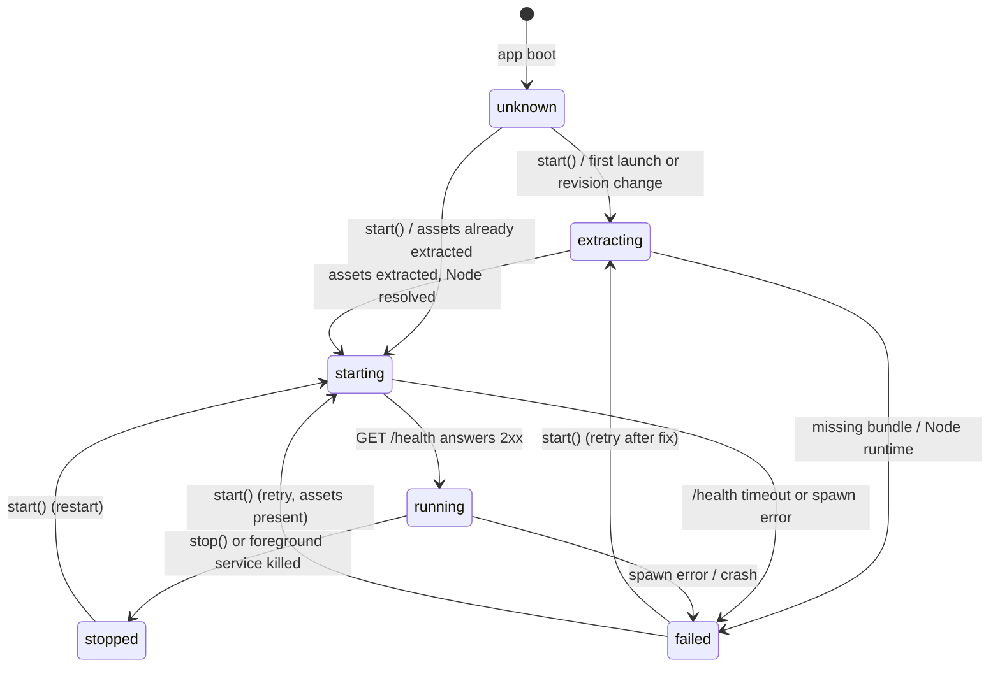

# OAgents architecture

This document expands the architecture section of the
[README](../README.md). It covers four contracts that together define how
OAgents drives a single AI backend — the opencode CLI embedded on-device:

1. The [opencode HTTP contract](#1-opencode-http-contract) — endpoints and
   the SSE event schema, from
   [`lib/services/opencode_client.dart`](../lib/services/opencode_client.dart).
2. The [platform channel contract](#2-platform-channel-contract) — method
   and event channels between Dart and the Kotlin
   `OpencodeRuntimeBridge`, from
   [`lib/services/opencode_runtime.dart`](../lib/services/opencode_runtime.dart)
   and
   [`android/app/src/main/kotlin/com/secretarrow/oagents/OpencodeRuntimeBridge.kt`](../android/app/src/main/kotlin/com/secretarrow/oagents/OpencodeRuntimeBridge.kt).
3. The [`OpencodeRuntimeState` state machine](#3-opencoderuntimestate-state-machine).
4. How the [agent loop, cron scheduler, subagents runner, and module
   runtime](#4-who-consumes-the-embedded-llmconfig) all consume the embedded
   `LlmConfig`.

The fixed loopback endpoint the embedded opencode listens on:

```dart
const String embeddedOpencodeUrl = 'http://127.0.0.1:4096';
const int embeddedOpencodePort = 4096;
```

This is reachable only from inside the app sandbox. No other app and no
network host can reach it, so the app → opencode hop needs no auth.

---

## 1. opencode HTTP contract

The contract lives in
[`lib/services/opencode_client.dart`](../lib/services/opencode_client.dart).
It is intentionally OpenAI-shaped so the wire format is well-understood,
trivially mockable (the mock server in `test/support/` is the only other
place this contract is implemented), and stable across opencode revisions.

Base URL is the fixed `embeddedOpencodeUrl` (no trailing slash). Auth is
`Authorization: Bearer <token>` only when the token is non-empty — for the
embedded runtime the token is always empty (loopback, unauthenticated).

### Endpoints

| Endpoint | Method | Purpose |
|---|---|---|
| `/health` | `GET` | Connection probe. Returns any `2xx` with no body. Used by the Kotlin bridge's startup poll and by the Settings → opencode "Test connection" affordance. |
| `/models` | `GET` | Feeds the model picker. Returns `{"data":[{"id":String,"name":String}]}`. A bare JSON array is also accepted. Items with an empty `id` are dropped. On any failure the picker falls back to manual entry (returns an empty list, never throws). |
| `/chat/completions` | `POST` | SSE stream. Request body below. |

### `POST /chat/completions` request body

```json
{
  "model": "<opencode model id, or empty>",
  "messages": [{"role": "system|user|assistant|tool", "content": "..."}],
  "stream": true,
  "tools": ["...optional OpenAI tool schema..."],
  "tool_choice": "auto",
  "stream_options": {"include_usage": true}
}
```

`tools` and `tool_choice` are sent only when tools are non-empty.
`stream_options.include_usage` asks the server for a final usage chunk;
servers that do not understand the field ignore it. If the server replies
`400` and the error body mentions `stream_options`, the client retries once
without it (usage simply stays null) so chat keeps working on stricter
frontends.

Request headers:

```
Authorization: Bearer <authToken>   // omitted when authToken is empty
Content-Type: application/json
Accept: text/event-stream
X-Title: OAgents
```

The body is JSON-encoded off the UI isolate (`Isolate.run`) because a long
conversation with base64 attachments can be multiple MB and a main-thread
`jsonEncode` stalls every frame.

### SSE event schema

The response is `Content-Type: text/event-stream`. Each event is a
`data: <json>\n\n` line. OAgents understands four shapes:

```
data: {"choices":[{"delta":{"content":"text chunk"}}]}              // assistant text
data: {"choices":[{"delta":{"tool_calls":[{...}]}}]}                 // tool call
data: {"choices":[],"usage":{"prompt_tokens":N,"completion_tokens":M}}  // usage
data: [DONE]                                                         // stream end
```

- **Text chunk** — `choices[0].delta.content` (a non-empty string) is
  appended to the running assistant text and emitted to the UI via
  `onDelta`.
- **Tool call** — `choices[0].delta.tool_calls` is an array; each entry is
  accumulated by `index` into a `_ToolAccumulator` (`id`, `function.name`,
  `function.arguments` streamed as a string). Tool-call JSON is only
  surfaced once the stream ends cleanly — a dropped socket mid-stream
  discards half-received tool calls (their JSON would be truncated) but
  keeps usable partial text.
- **Usage** — captured even on a chunk with empty `choices` (the final
  `include_usage` emission). Parsed into `TokenUsage`.
- **`[DONE]`** — stream end.

Lines starting with `:` (SSE comments) and empty lines are skipped. Lines
not starting with `data:` are skipped. Malformed JSON payloads are skipped
(the stream continues).

### Non-streaming fallback

If the server replies `200` but with a non-`text/event-stream`
`Content-Type` (it ignored `stream: true`), the client parses a plain JSON
response: `choices[0].message.content`, `choices[0].message.tool_calls`,
and `usage`.

### Error handling

- Non-2xx responses carry an error body surfaced verbatim, truncated to
  600 chars (300 for the `400` `stream_options` path) so auth and config
  mistakes are diagnosable in-app. The status code is attached to the
  `LlmException`.
- A connection failure (`client.send` throws) becomes
  `LlmException('Could not connect to opencode server: …')`.
- A dropped socket mid-stream becomes
  `LlmException('Connection lost while streaming: …')` unless partial text
  is recoverable and there are no in-flight tool calls.
- `isRetryableOpencodeError` returns true for transport failures (unreachable
  server, dropped stream, socket/timeout) and transient HTTP responses
  (`408` / `425` / `429` / `5xx`). Auth and bad-request errors are
  permanent — retrying them only burns the budget. A user-initiated abort
  (`LlmAbortedException`, the Stop button) is never retried.

### Per-call cancellation

Every `chatStream` call registers its `http.Client` with `LlmClient`'s live
stream registry under a `cancelKey`, so `LlmClient.forceCancel` can tear the
stream down mid-flight even when the stream has gone silent (the
`shouldAbort` poll only runs between chunks). The client is unregistered
and closed in a `finally` block.

---

## 2. Platform channel contract

The embedded opencode CLI lifecycle is driven through two channels between
Dart and the Kotlin `OpencodeRuntimeBridge`:

| Channel | Type | Name |
|---|---|---|
| Method | `MethodChannel` | `com.secretarrow.oagents/opencode` |
| Event | `EventChannel` | `com.secretarrow.oagents/opencode/status` |

### Method channel — `com.secretarrow.oagents/opencode`

Every method is defensive: nothing throws across the channel. A failure
comes back as a status map with `state = "failed"` and a human-readable
`message`.

| Method | Args | Returns | Effect |
|---|---|---|---|
| `start` | none | `{"state":"starting", …}` (immediate), then status events | Spawns a background thread that extracts bundled assets on first launch, resolves the Node runtime, starts the foreground service, spawns the opencode process, and polls `GET /health`. Emits `extracting` → `starting` → `running` (or `failed`). |
| `stop` | none | `{"state":"stopped", …}` | Destroys the opencode process (`destroyForcibly`) and stops the foreground service. Safe to call when already stopped. |
| `status` | none | current status map | Polls the current status without changing the runtime state. |
| `version` | none | `String` | The opencode version string read from the bundled `version.txt` at extraction time. Empty string if unavailable. |

`start` returns `starting` immediately (the heavy work is asynchronous on a
background thread); the real outcome arrives over the event channel.

### Event channel — `com.secretarrow.oagents/opencode/status`

A hot, broadcast stream emitted by the native bridge. On listen, the bridge
immediately emits the current status, then emits a new map on every
transition. The stream is shared across listeners (Settings screen, the chat
gate, the cron scheduler) so they all see the same events.

Each event is a map:

```json
{
  "state": "unknown|extracting|starting|running|stopped|failed",
  "version": "<opencode version, or empty>",
  "message": "<human-readable detail, or empty>",
  "bundledRevision": "<revision from version.txt, or empty>"
}
```

On the Dart side this is parsed by `OpencodeRuntimeStatus.fromMap`:

```dart
class OpencodeRuntimeStatus {
  final OpencodeRuntimeState state;   // parsed from the "state" string
  final String version;               // map['version']
  final String message;               // map['message']
  final String bundledRevision;       // map['bundledRevision']
  bool get isReady => state == OpencodeRuntimeState.running;
}
```

### Native bridge behavior (Kotlin side)

`OpencodeRuntimeBridge` does the heavy lifting:

1. **Extract** bundled assets from APK `assets/opencode/` to
   `filesDir/opencode/` on first launch or when the bundled revision
   changes: `opencode.bundle.js`, `version.txt`, and (optionally)
   `package.json`.
2. **Resolve the Node runtime** (first match wins):
   - `nativeLibraryDir/libnode.so` — the NodeJS Mobile shared lib (preferred;
     CI drops a per-ABI `libnode.so` into
     `android/app/src/main/jniLibs/<abi>/`, mapped into `nativeLibraryDir`
     at install time).
   - `filesDir/opencode/node-<abi>` — a static Node binary extracted per-ABI
     from `assets/opencode/node-<abi>` (Termux-style fallback).
   - If neither is present, the bridge emits `state = "failed"` with the
     message: *"No Node runtime found. The CI bundle-opencode job must drop
     libnode.so into android/app/src/main/jniLibs/<abi>/ or
     assets/opencode/node-<abi>. Rebuild the APK after bundling."* — and
     returns. The app still opens; Settings → opencode shows the failure.
3. **Start the foreground service** (`OAgentsForegroundService`) with a
   persistent notification and wake lock so a backgrounded app keeps the
   opencode process alive.
4. **Spawn** the opencode process:

   ```
   node --eval "process.env.PORT='4096'; require('./opencode.bundle.js')"
   ```
   with environment `PORT=4096` and `OPENCODE_SERVE=1`, working directory
   `filesDir/opencode/`, `redirectErrorStream` on. A daemon thread drains
   stdout so the child never blocks on a full pipe buffer.

5. **Poll `GET /health`** on `http://127.0.0.1:4096/health` (1s connect /
   read timeout, 500ms interval, ~20s deadline). On success emit
   `state = "running"`; on timeout emit `state = "failed"` with
   *"opencode did not answer /health within 20s. Check that
   opencode.bundle.js is a valid Node bundle."*

---

## 3. OpencodeRuntimeState state machine



States (from `lib/services/opencode_runtime.dart`):

| State | Meaning |
|---|---|
| `unknown` | Native bridge has not reported yet (boot window). |
| `extracting` | First launch: extracting the bundled opencode bundle + NodeJS Mobile libs from APK assets to private storage. Subsequent launches skip this unless the bundled version changed. |
| `starting` | opencode process spawned, waiting for `GET /health` to answer on `embeddedOpencodeUrl`. |
| `running` | opencode is up and serving on `embeddedOpencodeUrl`; chat is allowed. |
| `stopped` | opencode process is not running (user stopped it, or the app was backgrounded and the foreground service was killed). |
| `failed` | opencode failed to start (extraction error, libnode load failure, port conflict, `/health` timeout). The native bridge surfaces a human-readable `message`. |

`OpencodeRuntimeBridge.ensureReady()` (called at app boot from `main.dart`
and before the first chat send of a session) brings the runtime to
`running` and resolves; if it is already running it returns immediately.
It waits on the status stream for a `running` or `failed` transition, with
a 30s timeout that itself produces a `failed` status
(*"opencode did not become ready within 30s"*) so the user never sees a
"connection refused" from a not-yet-ready opencode.

Chat sends are gated on `isReady` (`state == running`).

---

## 4. Who consumes the embedded LlmConfig

OAgents has exactly one `LlmConfig`, built by a single resolver in
[`lib/di.dart`](../lib/di.dart):

```dart
LlmConfig resolveOpencodeLlmConfig(AppSettings settings) => LlmConfig(
  serverUrl: embeddedOpencodeUrl,   // http://127.0.0.1:4096
  authToken: '',                    // loopback, no auth
  model: settings.opencodeModel,    // the only user-tunable field
);
```

The only user-tunable field is `model` (`settings.opencodeModel`); everything
else is fixed by the embedded architecture. This single config is consumed
by every AI-touching subsystem:

### Agent loop — `agent_controller.dart`

The agent loop calls `resolveOpencodeLlmConfig(settings)` to build the
config for each turn, then streams through `llmClientProvider` (which is
wired to `OpencodeClient`). Tool fan-out, todo planning, and the composer
gate all flow through the same config. The model id is read from
`settings.opencodeModel` (e.g. `agent_controller.dart` line ~2104).

### Cron scheduler — `cron_scheduler.dart`

`CronScheduler` takes a `LlmConfig Function() resolveConfig` resolver. At
each scheduled tick it calls `resolveConfig()` to get a fresh config (so a
model change in Settings takes effect on the next run without restarting
the scheduler) and runs the scheduled agent turn through `llmClientProvider`.

### Subagents runner — `subagents.dart`

`SubagentsRunner` takes the same `LlmConfig Function() resolveConfig`
resolver. Each parallel subagent run resolves its own config from the
current settings, so the fan-of-subagents all route to the same embedded
opencode on the same loopback endpoint.

### Module runtime — `module_runtime.dart`

Chat modules do **not** hold an `LlmConfig` directly. A module's
`oagents.chat.emit(text)` / chat request is run through the **chat's own
LLM** (the same `llmClientProvider` wired to `OpencodeClient`) plus the
host-side composer gate. So a module indirectly consumes the embedded
`LlmConfig` via the chat it is attached to — a module never gets its own
server URL or token, and can never reach a different backend than the chat
that hosts it.

### The wiring

```dart
final opencodeRuntimeProvider = Provider<OpencodeRuntimeBridge>(
  (ref) => OpencodeRuntimeBridge(),
);

final opencodeClientProvider = Provider<OpencodeClient>(
  (ref) => OpencodeClient(),
);

final llmClientProvider = Provider<LlmClient>(
  (ref) => LlmClient(opencode: ref.watch(opencodeClientProvider)),
);
```

There is no provider multiplexing, no engine selection, and no AgentRouter
routing. opencode is the sole brain, and it runs on-device.

---

## Bundled-asset layout (CI-produced, gitignored)

The bridge expects this layout, produced by
`.github/workflows/bundle-opencode.yml` at build time and staged into the
APK assets / native libs:

```
android/app/src/main/assets/opencode/
├── opencode.bundle.js     # opencode source bundled into one Node-runnable file
├── version.txt            # opencode version + revision
└── package.json           # opencode's own package.json (optional; for the require graph)

android/app/src/main/jniLibs/
├── arm64-v8a/libnode.so   # NodeJS Mobile shared lib, per-ABI
├── armeabi-v7a/libnode.so
└── x86_64/libnode.so
```

Both `assets/opencode/` and `jniLibs/` are gitignored (see
[`.gitignore`](../.gitignore)); a `jniLibs/.gitkeep` placeholder keeps the
directory tracked so CI has a stable drop target. A build without these
artifacts opens the app but reports `state = failed` in Settings → opencode
with an actionable message.
